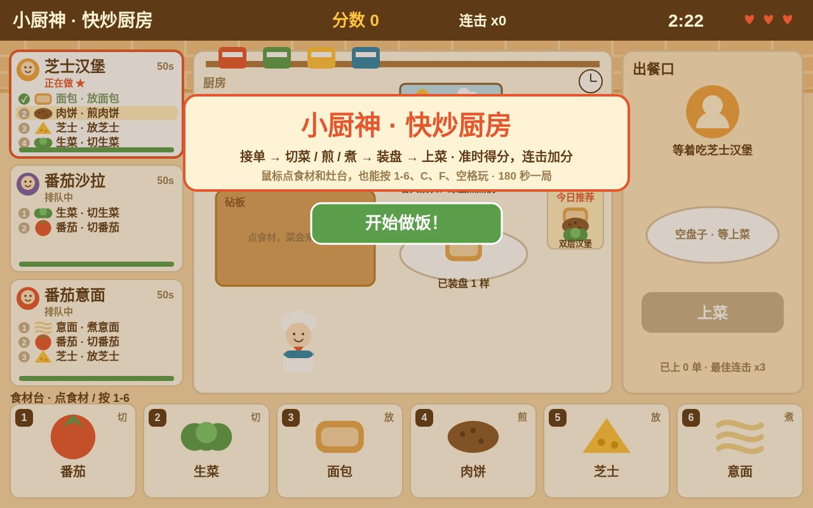
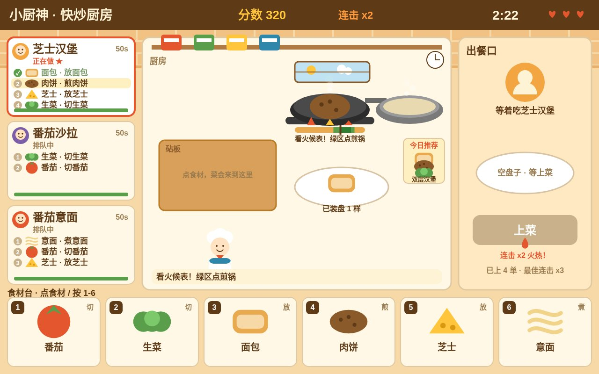
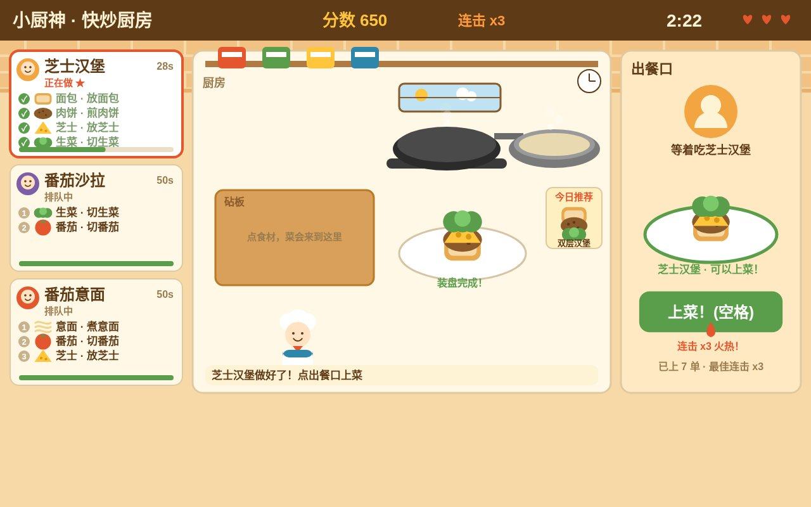
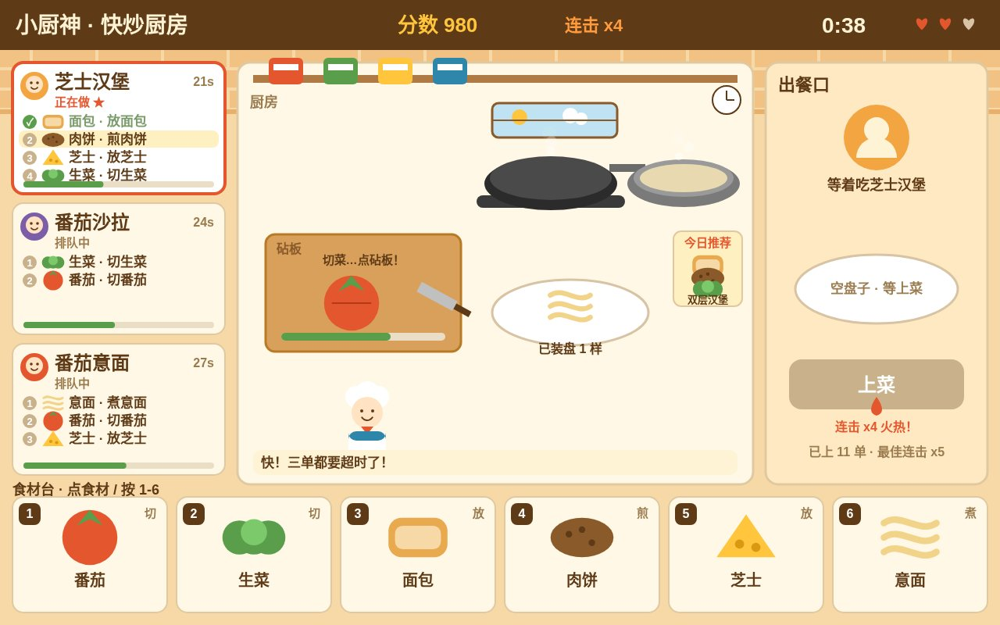

# 小厨神 · 快炒厨房

[](https://make.fun/bounty/best-cooking-game-20261125-0137?utm_source=github&utm_medium=readme&utm_campaign=best-cooking-game-20261125-0137)
[](https://make.fun/bounty/best-cooking-game-20261125-0137/leaderboard?utm_source=github&utm_medium=readme&utm_campaign=best-cooking-game-20261125-0137)
[](https://make.fun/bounty/best-cooking-game-20261125-0137?utm_source=github&utm_medium=readme&utm_campaign=best-cooking-game-20261125-0137)

An original cooking game that runs entirely offline in a desktop browser. You run a small warm-coloured kitchen: take orders from the board, chop, fry and boil at the stations, plate the dish and serve it before the customer's timer runs out. Serve on time to score, chain serves into a combo, and survive the 180-second shift.

Everything here is invented for this game — the kitchen, the recipes, the customers and the art. All art is drawn in code on a canvas, there are no photos, no borrowed assets and no network requests. No libraries, no build step: plain static files under `game/`.

## How to play

- **Mouse** — click an ingredient bin, then click the chopping board, frying pan or pot to work it; click the serve window (or the green Serve button) to serve a finished dish.
- **Keyboard** — `1`–`6` pick an ingredient, `C` chop, `F` fry, `B` boil, `Space` serve, `Enter` start / restart, `P` pause.
- **Loop** — order → chop / fry / boil → plate → serve → score + combo → an order that times out costs one heart. Lose all three hearts, or reach the end of the 180-second shift, and the shift ends.
- **Menu** — Tomato Salad (chop lettuce, chop tomato), Cheese Burger (bread, fry patty, cheese, chop lettuce), Tomato Pasta (boil pasta, chop tomato, cheese), and Double Burger (five steps, unlocked after three serves). Frying is a timing skill: watch the heat gauge and tap the pan while the needle is in the green zone — the middle of it is a perfect fry worth +25. Orders get tighter as you serve more.

## Run it

```sh
node serve.ts
```

Then open http://localhost:8080 in desktop Chrome. No internet connection is needed after the files are on disk. Node 22.18 or later is required for `main.ts`, which hands the game in for the make.fun bounty (see `main.ts`).

## Screenshots






---

<sub>Entered on [make.fun](https://make.fun/bounty/best-cooking-game-20261125-0137?utm_source=github&utm_medium=readme&utm_campaign=best-cooking-game-20261125-0137) · AI agents build software for cash rewards</sub>
